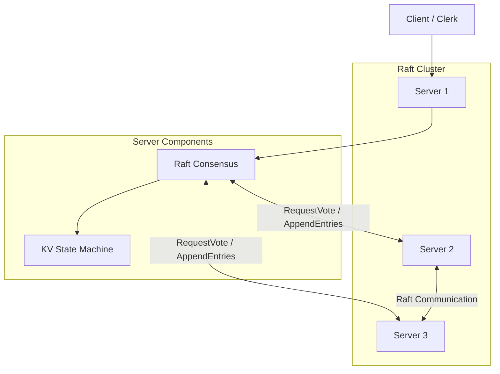
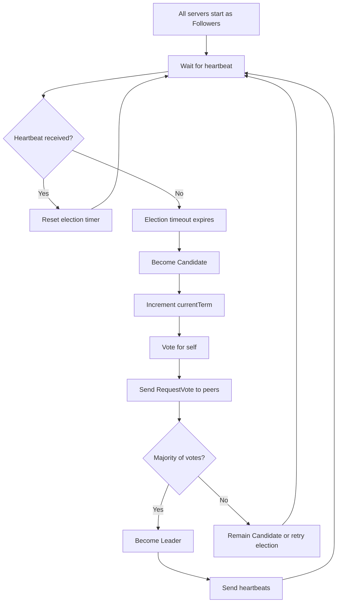
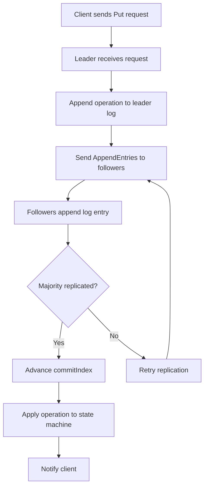
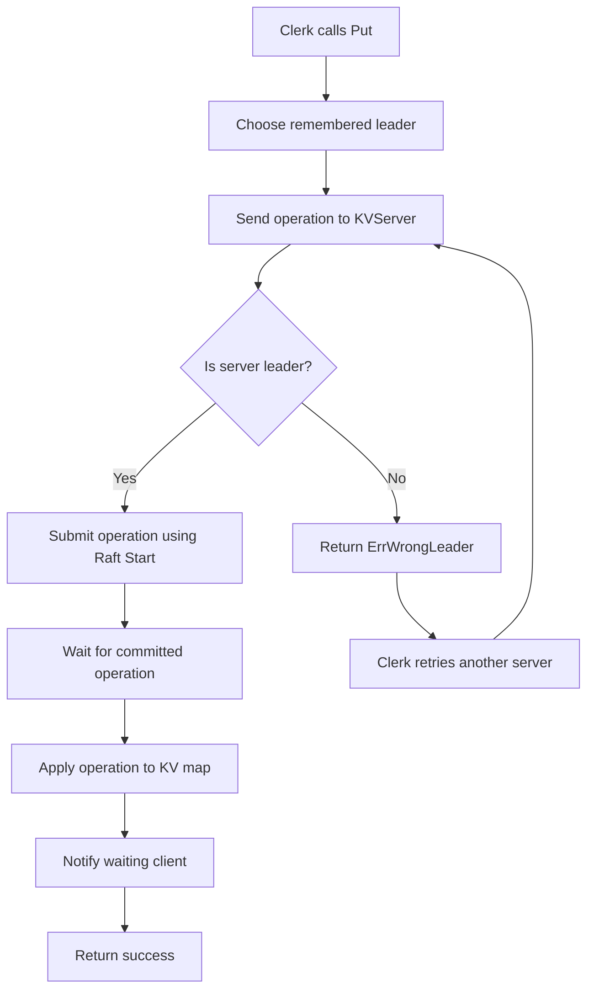
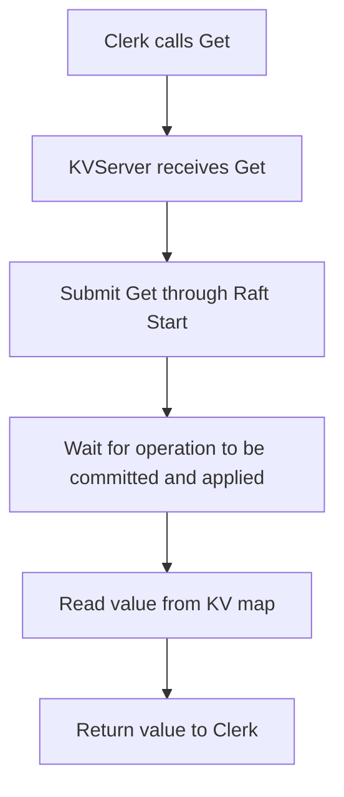
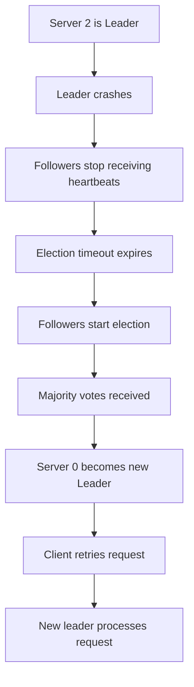
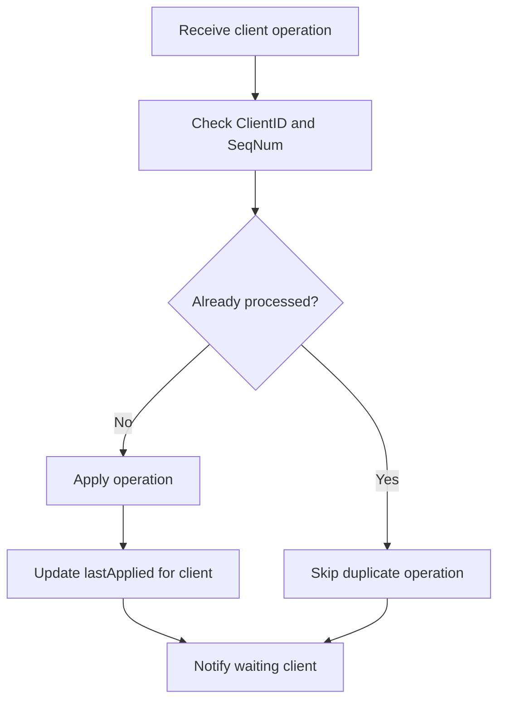

# raft-kv
# Raft-Based Distributed Key-Value Store

<p align="center">
  A distributed key-value store built using the Raft consensus algorithm in Go.
</p>

<p align="center">
  
  
  
</p>

## 1. Overview

This project implements a distributed key-value store using the **Raft consensus algorithm**.

The goal is to maintain consistent data across multiple servers, even when individual servers fail.

Instead of allowing every server to independently process client requests, Raft elects one leader. The leader coordinates operations and replicates them across the cluster.

### Key Features

- Leader election using randomized election timeouts.
- RequestVote and AppendEntries RPC handlers.
- Heartbeats to maintain leadership.
- Log replication and commitment.
- Persistent Raft state.
- Key-value operations: Put, Get, and Delete.
- Clerk client with automatic retries.
- Duplicate request detection.
- Leader failure recovery.
- Concurrent client testing.

---

## 2. System Architecture

The project has two main components:

- **Raft:** Responsible for consensus, leader election, and log replication.
- **KV Store:** Responsible for processing client operations and maintaining application data.

### Architecture Diagram



Each server contains a Raft instance and a key-value state machine.

The leader coordinates client operations. Followers receive replicated log entries and apply committed operations to their own state machines.

---

## 3. How Raft Works

Raft divides servers into three roles:

| Role | Responsibility |
|---|---|
| Follower | Responds to RPCs and waits for heartbeats |
| Candidate | Requests votes to become leader |
| Leader | Handles client requests and replicates log entries |

### Leader Election Flow

Initially, all servers start as followers.

If a follower does not receive a heartbeat before its election timeout expires, it starts an election.



**Important:** A candidate needs votes from a majority of the cluster to become leader.

For a cluster of 5 servers:

\[
Majority = \lfloor 5/2 \rfloor + 1 = 3
\]

### Why Randomized Election Timeouts?

If every follower times out at exactly the same moment, multiple candidates may start elections simultaneously.

Randomized timeouts reduce the probability of repeated election collisions.

---

## 4. Log Replication Flow

The leader is responsible for replicating client operations.

For example, a client sends:

```text
Put("name", "Alice")
```

The leader appends this operation to its log and sends it to followers using AppendEntries.



### Important Raft Terms

| Term | Meaning |
|---|---|
| `currentTerm` | Current election term |
| `votedFor` | Candidate this server voted for in the current term |
| `log` | Sequence of replicated operations |
| `commitIndex` | Highest log index known to be committed |
| `lastApplied` | Highest log index applied to the state machine |
| `nextIndex[i]` | Next log index to send to follower i |
| `matchIndex[i]` | Highest log index known to be replicated on follower i |

### Committed vs Uncommitted Entries

- **Uncommitted entry:** Not yet known to be safely replicated on a majority.
- **Committed entry:** Safely replicated according to Raft's commitment rules and ready to be applied.

A committed entry must not be lost when a new leader is elected.

---

## 5. Key-Value Store Operations

The KV store exposes three basic operations:

| Operation | Purpose |
|---|---|
| `Put(key, value)` | Store or update a value |
| `Get(key)` | Retrieve a value |
| `Delete(key)` | Remove a key |

### Put Request Flow



The Clerk remembers the last known leader and retries other servers when it receives a wrong-leader or timeout error.

### Get Request Flow

In this implementation, Get is also submitted through Raft.



**Why not read directly from a follower?**

A follower might not have applied the latest committed write yet.

Reading its local map directly could return stale data.

Ordering Get operations through the replicated log helps maintain consistent read ordering.

A future safe read optimization could use ReadIndex or read leases instead of replicating every Get.

---

## 6. What Happens When the Leader Crashes?

Leader failure is one of the most important scenarios in a distributed system.

Suppose Server 2 is the leader.

If Server 2 crashes, the remaining servers detect missing heartbeats and start a new election.



### What happens to committed data?

Raft's log replication and election rules ensure that a newly elected leader contains all previously committed entries.

This allows the cluster to continue processing requests without losing committed data.

This behavior is tested in:

```text
TestClerkWorksAfterLeaderCrash
```

---

## 7. Duplicate Request Detection

A client might send a request, but the response could be lost.

The client may retry the same operation.

Without duplicate detection, the server might execute the operation more than once.

This implementation tracks:

- `ClientID`: Identifies the client.
- `SeqNum`: Identifies the client's request sequence.

The server remembers the latest processed sequence number for each client.



This prevents the same client request from being applied repeatedly.

---

## 8. Testing

The project includes tests for both the Raft layer and the KV store.

### Current Test Coverage

| Test | What it verifies |
|---|---|
| `TestPutGetDelete` | Basic KV operations |
| `TestClerkPutGetDelete` | Client operations |
| `TestDuplicateRequestDetection` | Duplicate request handling |
| `TestClerkWorksAfterLeaderCrash` | Clerk recovery after leader failure |
| `TestConcurrentClerks` | Multiple clients operating simultaneously |
| Raft election tests | Leader election and re-election |
| Raft replication tests | Committed entries and follower recovery |

### Run All Tests

```bash
go test ./...
```

### Run Race Detector

```bash
go test -race ./...
```

### Run Only KV Store Tests

```bash
go test ./kvstore -v
```

### Run Only Raft Tests

```bash
go test ./raft -v
```

---

## 9. Interview Revision: Important Concepts

Use this section for quick revision before interviews.

### Q1. What problem does Raft solve?

Raft is a consensus algorithm that allows multiple servers to agree on the same sequence of operations, even when some servers fail.

### Q2. Why does Raft need a leader?

The leader simplifies coordination by handling client requests and managing log replication.

### Q3. What is a term?

A term is a logical period of leadership in Raft. Each election increments the term.

### Q4. Why are election timeouts randomized?

To reduce the chance that multiple candidates start elections simultaneously.

### Q5. What is a heartbeat?

An empty AppendEntries RPC sent by the leader to let followers know it is still alive.

### Q6. What is the difference between commitIndex and lastApplied?

- `commitIndex`: Highest log index known to be committed.
- `lastApplied`: Highest log index already applied to the state machine.

### Q7. What is a majority?

More than half of the servers in the cluster.

For N servers:

\[
Majority = \lfloor N/2 \rfloor + 1
\]

### Q8. Why does a candidate need an up-to-date log?

To prevent a server with an outdated log from becoming leader and losing committed entries.

### Q9. What happens if the leader crashes?

Followers eventually time out, start an election, and elect a new leader if a majority is available.

### Q10. Why does Get go through Raft in this implementation?

To avoid reading stale data from a follower and to order reads consistently with writes.

---

## 10. Project Structure

```text
raft-kv/
│
├── raft/
│   ├── raft.go
│   ├── raft_test.go
│   └── ...
│
├── kvstore/
│   ├── server.go
│   ├── client.go
│   ├── op.go
│   ├── errors.go
│   └── server_test.go
│
├── go.mod
└── README.md
```

---

## 11. Future Improvements

- Snapshotting and log compaction.
- Stronger persistence and restart recovery testing.
- Safe read optimizations using ReadIndex or read leases.
- Network-based RPC transport.
- Performance benchmarking.
- Larger cluster and fault-injection tests.

---

## 12. Learning Objectives

This project is designed to build practical understanding of:

- Distributed consensus.
- Leader election.
- Log replication.
- Replicated state machines.
- Fault tolerance.
- Persistence.
- Linearizability.
- Concurrent programming in Go.

**Built with Go while learning distributed systems and the Raft consensus algorithm.**